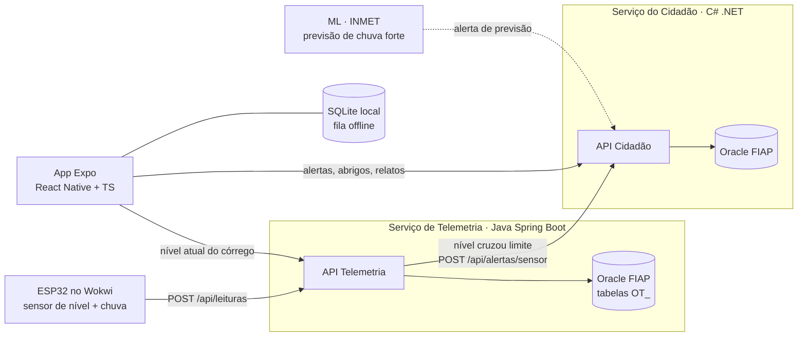
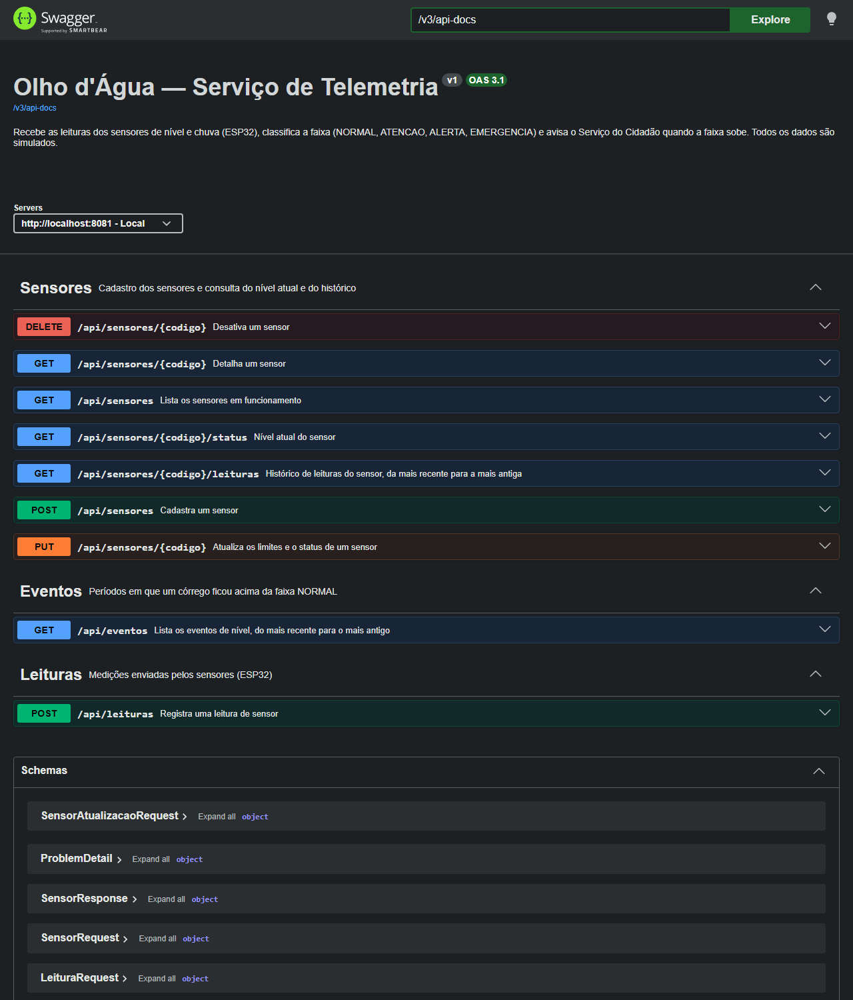
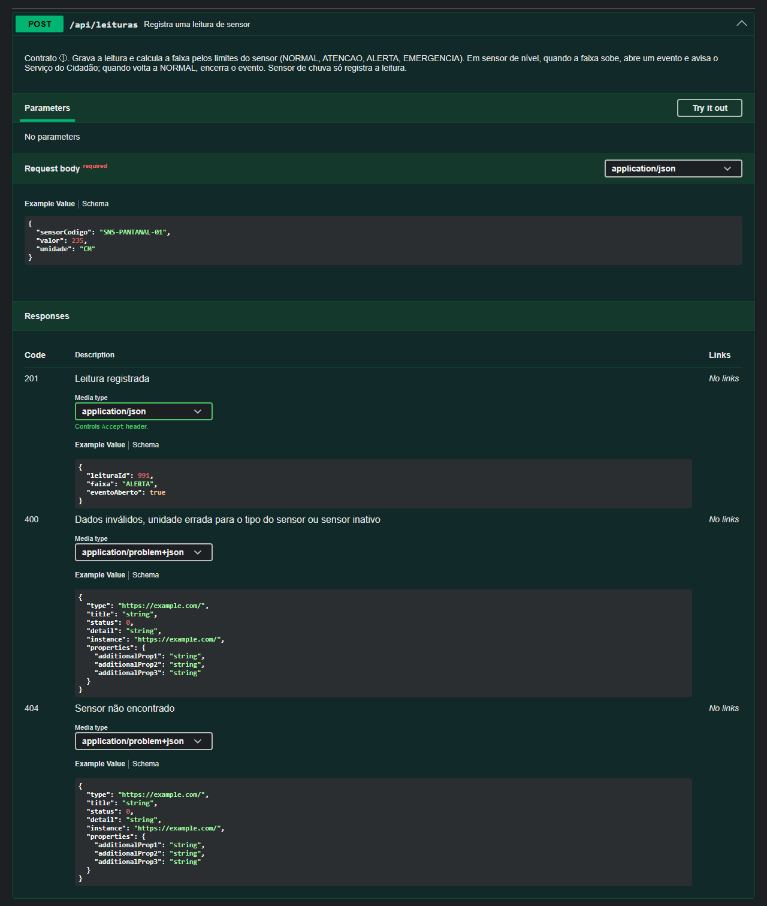
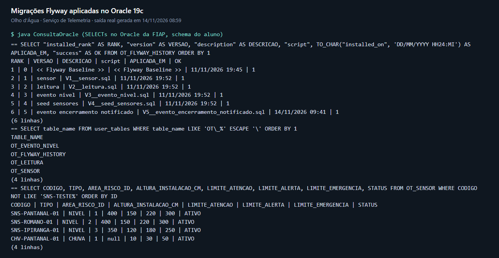
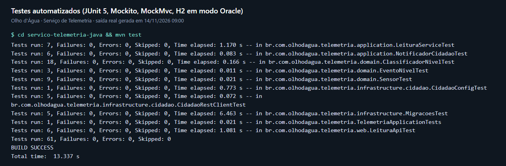
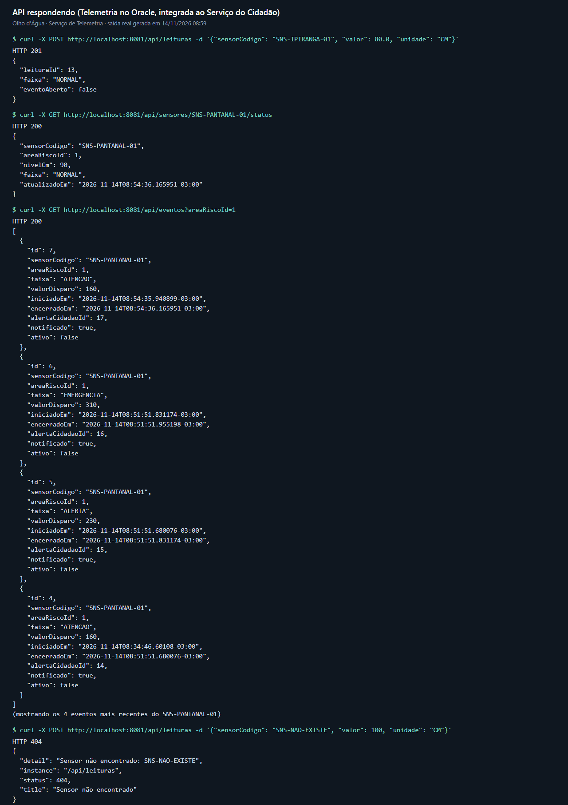

# Olho d'Água — alerta comunitário de alagamentos

> Global Solution 2026.2 · FIAP · Engenharia de Software · CitizenTech

## Ficha da CitizenTech

| Campo | Resposta |
|---|---|
| **Nome** | Olho d'Água |
| **Cidade e bairro** | São Paulo — Jardim Pantanal, em São Miguel Paulista (zona leste), na várzea do Rio Tietê. Os dados de demonstração também cobrem o Jardim Romano e a região do Córrego Ipiranga |
| **Cidadão beneficiado** | Morador de área de risco de alagamento — em especial idosos, pessoas com mobilidade reduzida e famílias que moram perto de córregos |
| **Problema, em uma frase** | Quem mora perto de córregos em São Paulo só descobre que a rua vai alagar quando a água já está entrando em casa, sem tempo para proteger pessoas, documentos e bens. |
| **Como funciona** | Sensores de baixo custo medem o nível do córrego e a chuva; quando o nível cruza um limite, o morador inscrito naquela área recebe um alerta no celular com o que fazer e o abrigo mais próximo. Os próprios moradores também reportam alagamentos pelo app, e relatos confirmados viram alerta comunitário. |
| **O que cada parte faz** | **ESP32 (IoT)** mede o nível · **Serviço de Telemetria (Java/SOA)** recebe leituras e detecta limites · **Serviço do Cidadão (C#)** gera alertas, guarda relatos, áreas e abrigos · **App (Expo)** mostra alertas, recebe relatos (funciona offline) e indica abrigos · **ML** prevê chuva forte a partir de dados do INMET · **Linux (SO)** provisiona e monitora os serviços |
| **Link do repositório** | https://github.com/PeOliveira18/GlobalSolution-SOA |
| **Indicador de impacto** | Minutos de antecedência entre o alerta e o transbordamento · nº de moradores alertados por evento · % de relatos confirmados pela comunidade |
| **ODS conectados** | **ODS 11** (meta 11.5: reduzir mortes e perdas por desastres) · **ODS 13** (meta 13.1: resiliência a riscos climáticos) · **ODS 10** (a população mais exposta é a de baixa renda em áreas de várzea) |

## Arquitetura



**Por que dois serviços:** cada um tem uma responsabilidade clara. A Telemetria só conversa com hardware (muitas leituras, regras de limite). O serviço do Cidadão conversa com pessoas (alertas, relatos, abrigos). Eles se integram por REST: é a parte "orientada a serviços" da entrega de SOA, e deixa as entregas de SOA e C# separadas.

<!-- ESTE-REPO:INICIO -->
## Este repositório: SOA e Web Services

Entrega da disciplina **Arquitetura Orientada a Serviços (SOA) e Web Services**: o **Serviço de Telemetria**, em Java 21 + Spring Boot 4, com Oracle 19c, Flyway e Swagger (springdoc).

Ele recebe as leituras dos sensores (ESP32), classifica o nível do córrego em faixas (**NORMAL → ATENCAO → ALERTA → EMERGENCIA**) e, quando a faixa sobe, avisa o Serviço do Cidadão por REST. Quando o nível volta ao normal, pede o encerramento do alerta. Se o Serviço do Cidadão estiver fora do ar, a leitura não falha: o aviso fica pendente e é reenviado automaticamente.

```
GlobalSolution-SOA/
├── README.md                      ← esta página
├── PLANO.md                       ← cópia do plano mestre (oficial no repositório Olho-dagua)
├── prompts.md                     ← registro do uso de IA
├── docs/prints/                   ← evidências (Swagger, migrações, testes, API)
└── servico-telemetria-java/
    ├── pom.xml
    ├── .env.example               ← modelo das variáveis (o .env real não vai para o Git)
    └── src/
        ├── main/java/br/com/olhodagua/telemetria/
        │   ├── domain/            ← entidades e regras (Sensor, Leitura, EventoNivel, ClassificadorNivel)
        │   ├── application/       ← casos de uso (LeituraService, SensorService, NotificadorCidadao) e DTOs
        │   ├── infrastructure/    ← repositórios Spring Data, cliente HTTP do Cidadão, configurações
        │   └── web/               ← controllers REST e tratamento de erros (ProblemDetail)
        ├── main/resources/
        │   ├── application.yml
        │   └── db/migration/      ← V1 a V5 (Flyway, SQL do Oracle)
        └── test/java/...          ← 61 testes (JUnit 5, Mockito, MockMvc)
```

### Como rodar

**Pré-requisitos:** JDK 21 ou mais novo (testado no JDK 23) e Maven 3.9 (ou o `mvnw` que vem no projeto). Para os alertas chegarem ao app, o [Serviço do Cidadão](https://github.com/PeOliveira18/Olho-dagua) precisa estar rodando em `http://localhost:5080`.

**1. Configure as variáveis** (no PowerShell, trocando `SEU_RM` e `SUA_SENHA`; a chave de integração é a mesma configurada em `Integracao:ApiKey` no Serviço do Cidadão):

```powershell
$env:SPRING_DATASOURCE_URL = "jdbc:oracle:thin:@oracle.fiap.com.br:1521/ORCL"
$env:SPRING_DATASOURCE_USERNAME = "SEU_RM"
$env:SPRING_DATASOURCE_PASSWORD = "SUA_SENHA"
$env:CIDADAO_BASE_URL = "http://localhost:5080"
$env:CIDADAO_API_KEY = "CHAVE_DE_INTEGRACAO"
```

Outra opção: copie `servico-telemetria-java/.env.example` para `servico-telemetria-java/.env` e preencha. O `.env` é lido ao subir e está no `.gitignore`.

**2. Suba o serviço:**

```powershell
cd servico-telemetria-java
mvn spring-boot:run
```

A API fica em `http://localhost:8081/api` e a documentação em **http://localhost:8081/swagger-ui.html** (contrato OpenAPI em `/v3/api-docs`).

**3. Rode os testes** (não precisam do Oracle nem do Serviço do Cidadão: usam H2 em memória no modo Oracle):

```powershell
cd servico-telemetria-java
mvn test
```

### Banco de dados e migrações

- **Banco:** Oracle 19c da FIAP. O schema é compartilhado com outras matérias, então **todas as tabelas deste serviço têm o prefixo `OT_`**: `OT_SENSOR`, `OT_LEITURA`, `OT_EVENTO_NIVEL`. O histórico do Flyway fica em `OT_FLYWAY_HISTORY`.
- **Quem cria as tabelas é o Flyway**, ao subir a aplicação. O Hibernate só confere se as entidades batem com o banco (`ddl-auto: validate`).
- **Criar o banco do zero:** num usuário Oracle sem as tabelas `OT_`, basta rodar `mvn spring-boot:run`. O Flyway aplica as migrações em ordem e registra cada uma no histórico.

| Migração | O que faz |
|---|---|
| `V1__sensor.sql` | cria `OT_SENSOR` (código único, tipo, limites, status) com CHECKs de limites crescentes e altura de instalação |
| `V2__leitura.sql` | cria `OT_LEITURA` com FK para o sensor e índice em (sensor, data) |
| `V3__evento_nivel.sql` | cria `OT_EVENTO_NIVEL` com FK para o sensor |
| `V4__seed_sensores.sql` | carrega os 4 sensores simulados |
| `V5__evento_encerramento_notificado.sql` | **evolução do esquema:** `ALTER TABLE` que acrescenta a coluna usada no reenvio de encerramentos |

### Endpoints

| Método | Rota | O que faz |
|---|---|---|
| POST | `/api/leituras` | registra uma leitura do sensor e calcula a faixa (contrato ①) |
| GET | `/api/sensores?areaRiscoId=&tipo=` | lista os sensores em funcionamento |
| GET | `/api/sensores/{codigo}` | detalha um sensor |
| POST | `/api/sensores` | cadastra um sensor |
| PUT | `/api/sensores/{codigo}` | atualiza limites e status |
| DELETE | `/api/sensores/{codigo}` | desativa o sensor (exclusão lógica: status `INATIVO`, histórico mantido) |
| GET | `/api/sensores/{codigo}/status` | nível atual, a partir da última leitura (contrato ④) |
| GET | `/api/sensores/{codigo}/leituras?desde=&ate=&page=&size=` | histórico paginado, do mais recente para o mais antigo |
| GET | `/api/eventos?ativos=&areaRiscoId=` | períodos em que o córrego ficou acima de NORMAL |

Os erros seguem o padrão **ProblemDetail (RFC 7807)**: 400 para dados inválidos ou regra do sensor violada, 404 para sensor inexistente e 409 para código de sensor repetido.

Exemplo do contrato ①:

```http
POST /api/leituras
{ "sensorCodigo": "SNS-PANTANAL-01", "valor": 235.0, "unidade": "CM" }

201 Created
{ "leituraId": 991, "faixa": "ALERTA", "eventoAberto": true }
```

### Integração com o Serviço do Cidadão (SOA)

| Quando | Chamada | Contrato |
|---|---|---|
| A faixa sobe (ex.: ATENCAO → ALERTA) | `POST /api/alertas/sensor` com o header `X-Api-Key`; o `alertaId` devolvido fica guardado no evento | ② |
| O nível volta a NORMAL | `PATCH /api/alertas/{alertaId}/encerrar` com o header `X-Api-Key` | ③ |

- O Serviço do Cidadão encerra sozinho o alerta anterior do mesmo sensor quando chega um novo, então a Telemetria só chama o contrato ③ na volta ao normal.
- **Resiliência:** se o Cidadão estiver fora do ar, a leitura é gravada normalmente, o evento fica com `notificado = false` e um agendamento (`@Scheduled`, a cada 1 minuto) reenvia os alertas e encerramentos pendentes quando ele volta.
- Sensores de chuva (`CHV-...`) registram leituras e faixa, mas não abrem alerta no Cidadão.

### Rubrica → onde está no código

| Critério | Pontos | Onde está |
|---|---|---|
| **Estruturação do domínio** | 3,0 | Camadas `domain` / `application` / `infrastructure` / `web`. Regras dentro das entidades: `Sensor` recusa limites fora de ordem, sensor de nível sem altura e leitura com unidade errada, negativa, acima da altura ou de sensor inativo; `EventoNivel` só existe acima de NORMAL; `ClassificadorNivel` calcula a faixa sem depender do Spring. Entrada e saída por DTOs `record` com Bean Validation. Relacionamento Sensor 1—N Leitura e Sensor 1—N EventoNivel. |
| **Conexão com banco** | 3,0 | Oracle 19c via Spring Data JPA (`infrastructure/repository`). Credenciais só por variável de ambiente ou `.env` local, com `.env.example`. CRUD completo de sensores. FKs de `OT_LEITURA` e `OT_EVENTO_NIVEL` para `OT_SENSOR`. Consultas além do CRUD: histórico por período com paginação, eventos ativos por área, alertas e encerramentos pendentes. |
| **Migrações** | 1,5 | Flyway, V1 a V5 em `src/main/resources/db/migration`. Seed na V4, evolução do esquema na V5, `ddl-auto: validate`. O banco é criado do zero com `mvn spring-boot:run`. |
| **Documentação automática** | 1,5 | springdoc em `/swagger-ui.html`: todo endpoint com tag e resumo, exemplos em `@Schema`, respostas de erro (400, 404, 409) documentadas com `ProblemDetail`. |
| **Testes automatizados** | 1,0 | `mvn test`, 61 testes: domínio sem banco e sem HTTP (`ClassificadorNivelTest` com todos os valores de fronteira, `SensorTest`, `EventoNivelTest`), Mockito (`LeituraServiceTest`, `NotificadorCidadaoTest`), contrato HTTP com o Cidadão (`CidadaoRestClientTest`, `CidadaoConfigTest`), migrações (`MigracoesTest`) e API com MockMvc (`LeituraApiTest`). |

### Evidências

**Swagger com todos os endpoints**



**Contrato ① documentado, com exemplo e respostas de erro**



**Migrações aplicadas no Oracle** (histórico do Flyway, tabelas `OT_` e sensores carregados pela V4; horários do servidor Oracle)



**Testes passando**



**API respondendo**, já integrada ao Serviço do Cidadão (os eventos mostram o `alertaCidadaoId` devolvido por ele)



### Dados

Todos os dados são **simulados**: não há dados pessoais. Os 4 sensores e seus limites vêm da seção B4 do [PLANO.md](PLANO.md).

| Sensor | Tipo | Área de risco | Altura (cm) | Atenção | Alerta | Emergência |
|---|---|---|---|---|---|---|
| SNS-PANTANAL-01 | NIVEL | 1 · Várzea do Jardim Pantanal | 400 | 150 | 220 | 300 |
| SNS-ROMANO-01 | NIVEL | 2 · Jardim Romano | 400 | 150 | 220 | 300 |
| SNS-IPIRANGA-01 | NIVEL | 3 · Córrego Ipiranga | 350 | 120 | 180 | 250 |
| CHV-PANTANAL-01 | CHUVA | 1 · Várzea do Jardim Pantanal | — | 10 mm/h | 30 mm/h | 50 mm/h |

As coordenadas dos sensores são aproximadas e usam o centro de cada área. Os ids das áreas são os mesmos do Serviço do Cidadão.

### Uso de IA

A IA foi usada como copiloto, e os prompts estão registrados em [prompts.md](prompts.md).
<!-- ESTE-REPO:FIM -->

## Repositórios do projeto

| Parte | Disciplina | Repositório |
|---|---|---|
| Serviço do Cidadão (.NET) | C# Software Development | https://github.com/PeOliveira18/Olho-dagua |
| Serviço de Telemetria (Java) | SOA e Web Services | https://github.com/PeOliveira18/GlobalSolution-SOA |
| App do morador (Expo) | Mobile Development & IOT | https://github.com/PeOliveira18/GlobalSolution-Mobile |

## Plano do projeto

O planejamento completo (contratos entre serviços, portas, dados de seed, o que cada disciplina entrega e o cronograma até 19/11) está em **[PLANO.md](PLANO.md)**.

## Links das entregas

| Disciplina | Link |
|---|---|
| Vídeo do app (Mobile) | *a definir* |
| Projeto Wokwi (IoT) | *a definir* |
| Vídeo IoT | *a definir* |
| Vídeo ML | *a definir* |
| Vídeo Linux (OS) | *a definir* |
| Pitch (Testing) | *a definir* |

## Integrantes

| Nome | RM |
|---|---|
| Pedro Oliveira | 99943 |
| Debora Ivanowski | 555694 |
| Diego Cabral | 557817 |
